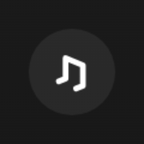
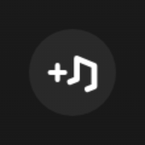
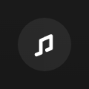
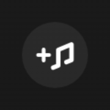
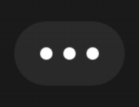
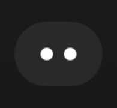
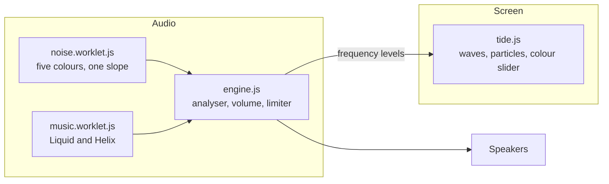

<p align="center">
  
</p>

<h1 align="center">Noise</h1>

<p align="center">
  <strong>Five colours of noise for focus and sleep.</strong><br/>
  A free app for Mac, Windows, Linux, and the web.
</p>

<p align="center">
  <a href="https://github.com/furey/noise/releases/latest"></a>
  
  
  
</p>

<p align="center">
  <a href="#download"><strong>Download for your computer →</strong></a>
</p>

> [!TIP]<br>
> Prefer the retro arcade look? Try [Noise 8bit](https://github.com/furey/noise-8bit).

<p align="center">
  <a href="https://youtu.be/QDL49afHRXk"></a><br/>
  <a href="https://youtu.be/QDL49afHRXk">Watch on YouTube</a>
</p>

## Contents

- [Overview](#overview)
- [Download](#download)
- [First open](#first-open)
- [Web app](#web-app)
- [Using the app](#using-the-app)
- [Privacy](#privacy)
- [Development](#development)
- [Disclaimer](#disclaimer)
- [Contributing](#contributing)
- [Support](#support)

## Overview

**Noise** plays steady noise to help you focus or sleep. It can also play music that follows the colour, over the noise or on its own. There are five colours of noise. Each colour is a slope: the change in loudness from one octave to the next. A lower colour has more bass; a higher colour has more treble.

| Colour | Slope            | Key |
| ------ | ---------------- | --- |
| Brown  | `−6 dB` / octave | `1` |
| Pink   | `−3 dB` / octave | `2` |
| White  | `0 dB` / octave  | `3` |
| Blue   | `+3 dB` / octave | `4` |
| Violet | `+6 dB` / octave | `5` |

Between two colours, the sound is a blend of both. Noise has no accounts, no tracking, and no adverts.

## Download

Choose your computer below. Each link downloads the newest version.

| Computer                                  | Download                                                                                                       |
| ----------------------------------------- | -------------------------------------------------------------------------------------------------------------- |
| Mac (any Mac)                             | [`Noise-Mac.dmg`](https://github.com/furey/noise/releases/latest/download/Noise-Mac.dmg)                       |
| Mac with an Apple chip (smaller download) | [`Noise-Mac-Apple-Chip.dmg`](https://github.com/furey/noise/releases/latest/download/Noise-Mac-Apple-Chip.dmg) |
| Mac with an Intel chip (smaller download) | [`Noise-Mac-Intel.dmg`](https://github.com/furey/noise/releases/latest/download/Noise-Mac-Intel.dmg)           |
| Windows PC                                | [`Noise-Windows.exe`](https://github.com/furey/noise/releases/latest/download/Noise-Windows.exe)               |
| Linux                                     | [`Noise-Linux.AppImage`](https://github.com/furey/noise/releases/latest/download/Noise-Linux.AppImage)         |
| Linux on ARM (such as a Raspberry Pi)     | [`Noise-Linux-ARM.AppImage`](https://github.com/furey/noise/releases/latest/download/Noise-Linux-ARM.AppImage) |

If you are not sure which Mac you have, download the first Mac file; it works on every Mac. To check the chip, open the Apple menu and choose **About This Mac**. A **Chip** line (Apple M1, M2, or later) means an Apple chip. A **Processor** line that says Intel means an Intel chip.

On a phone or tablet, use the [web app](#web-app). All versions are on the [releases page](https://github.com/furey/noise/releases).

## First open

- [First open overview](#first-open-overview)
- [First open on a Mac](#first-open-on-a-mac)
- [First open on Windows](#first-open-on-windows)
- [First open on Linux](#first-open-on-linux)

### First open overview

Noise is free, with the source code public. Anyone can read its code in this repository. Apple and Microsoft charge every year for the certificate that signs an app, so the app is unsigned. Because of this, your computer shows a warning the first time you open it. The steps below show each warning and the button to press.

> [!NOTE]<br>
> The pictures in the steps below are illustrations of the system messages, not screenshots. The wording on your computer can differ a little.

The desktop app blocks all network access from its pages. It reads and writes only its own settings, plus the shared music folder if you add a [music driver](docs/music-driver.md).

### First open on a Mac

Your steps depend on your macOS version. To check it, open the Apple menu and choose **About This Mac**.

- [macOS 15 Sequoia and later](#mac-macos-15-sequoia-and-later)
- [macOS 14 Sonoma and earlier](#mac-macos-14-sonoma-and-earlier)

#### Mac: macOS 15 Sequoia and later

1. Open the `.dmg` file you downloaded.
2. Drag **Noise** into the **Applications** folder.
3. Open the **Applications** folder and double-click **Noise**.
4. A message says "Noise" Not Opened. Click **Done**. Do not click **Move to Trash**.

   <p align="center">
     
     <br/><em>Illustration: the first macOS message</em>
   </p>
5. Open the Apple menu and choose **System Settings**.
6. Click **Privacy & Security** in the sidebar.
7. Scroll down to the **Security** section.
8. Next to "Noise" was blocked to protect your Mac, click **Open Anyway**.

   <p align="center">
     
     <br/><em>Illustration: Open Anyway in Privacy &amp; Security</em>
   </p>
9. Click **Open Anyway** in the next message.

   <p align="center">
     
     <br/><em>Illustration: the Open Anyway message</em>
   </p>
10. Type your Mac login password, or use Touch ID, when your Mac asks.

The **Open Anyway** button stays for about one hour after you first try to open the app. If it is gone, do steps 3 and 4 again, then continue from step 5.

#### Mac: macOS 14 Sonoma and earlier

1. Open the `.dmg` file you downloaded.
2. Drag **Noise** into the **Applications** folder.
3. Open the **Applications** folder.
4. Hold the Control key and click **Noise**.
5. Choose **Open**.
6. Click **Open** in the message.

   <p align="center">
     
     <br/><em>Illustration: the Open message</em>
   </p>

You do these steps once. After that, the app opens with a double-click.

### First open on Windows

Microsoft Edge can stop the download with the message **Noise-Windows.exe isn't commonly downloaded**. Edge shows this message for new files that few people have downloaded. To keep the file:

1. In the Edge downloads list, point to the file and click the **...** (More actions) button.
2. Click **Keep**.
3. If Edge asks again, click **Show more**.
4. Click **Keep anyway**.

To open the app after the download:

1. Double-click the `.exe` file you downloaded.
2. If a blue message says Windows protected your PC, click **More info**. If no message appears, go to step 5.

   <p align="center">
     
     <br/><em>Illustration: Windows protected your PC</em>
   </p>
3. If you saw the message, check that the **Publisher** line says Unknown publisher.
4. If you saw the message, click **Run anyway**.

   <p align="center">
     
     <br/><em>Illustration: Run anyway</em>
   </p>
5. Wait for the app to install and open. It installs for your Windows user only, and it is in the Start menu after that.

### First open on Linux

1. Open your file manager and find the `.AppImage` file you downloaded.
2. Right-click the file and choose **Properties**.
3. Click the **Permissions** tab.
4. Turn on **Allow executing file as program**. Newer versions of GNOME Files call it **Executable as Program**. KDE Dolphin calls it **Is executable**.

   <p align="center">
     
     <br/><em>Illustration: Allow executing file as program</em>
   </p>
5. Close the **Properties** window.
6. Double-click the file.

To do the same in a terminal, run these commands in the folder with the file. On Linux on ARM, the file is `Noise-Linux-ARM.AppImage`.

```console
chmod +x Noise-Linux.AppImage
./Noise-Linux.AppImage
```

If the app does not open on Ubuntu 22.04 or later, install FUSE, which every AppImage needs:

- On Ubuntu 22.04, run `sudo apt install libfuse2`.
- On Ubuntu 24.04 or later, run `sudo apt install libfuse2t64`.

## Web app

Open [noise.furey.dev](https://noise.furey.dev) in a browser on any device. You do not need to install anything.

To add Noise to the home screen of a phone or tablet:

- **iPhone or iPad**: open the page in Safari, tap the **Share** button, then tap **Add to Home Screen**.
- **Android**: open the page in Chrome, tap the **⋮** menu, then tap **Add to Home screen** or **Install app**.

From the home screen, Noise opens full screen and works offline after the first visit. iOS plays only one copy at a time: if Noise is open in Safari and on the home screen, the copy you tap takes the sound.

## Using the app

- [Controls](#controls)
- [Buttons](#buttons)
- [Music](#music)
- [Wave mode](#wave-mode)
- [Keyboard](#keyboard)
- [Music search](#music-search)
- [Desktop app](#desktop-app)

### Controls

- **Play or pause**: tap the screen.
- **Colour**: tap or drag the colour slider.
- **Volume**: while the sound plays, drag up or down, from `10%` to `100%`.

On a touch screen, the colour slider shows after the first tap. Noise remembers your colour, volume, wave mode, and music.

### Buttons

Three controls sit along the top of the screen. Each tap moves a control to its next setting.

**Wave mode** (top left):

| Button                                                                 | Setting                         |
| ---------------------------------------------------------------------- | ------------------------------- |
|  | Off                             |
|    | On; see [Wave mode](#wave-mode) |

**Music** (the top-middle button):

| Button                                                                                   | Setting               |
| ---------------------------------------------------------------------------------------- | --------------------- |
|                       | No music              |
|           | Liquid, alone         |
|  | Liquid over the noise |
|             | Helix, alone          |
|    | Helix over the noise  |

**Sleep timer** (top right):

| Button                                                                    | Setting      |
| ------------------------------------------------------------------------- | ------------ |
|        | Off          |
|  | `30` minutes |
|  | `20` minutes |
|  | `10` minutes |

The timer counts down only while the sound plays, and the sound fades out over the last minute.

The desktop app:

<https://github.com/user-attachments/assets/872f02e1-9816-49fa-bde4-2840069097b2>

On a tablet:

<https://github.com/user-attachments/assets/b237829a-0c25-40ee-b4f7-33c86f9a8a52>

On a phone:

<https://github.com/user-attachments/assets/ffe00bfa-b242-4a42-8376-020a3651cd43>

### Music

Music is optional. There are two pieces, Liquid and Helix, and each plays either on its own or mixed with the noise. Liquid is a soft synth with a slow bass. Helix is an organ that seems to rise forever. Both make up new notes as they play, so they do not repeat. The music follows the colour: low and dark at brown, high and bright at violet. In wave mode, it rises and falls with the wave.

### Wave mode

<picture>
  <source media="(prefers-color-scheme: dark)" srcset="docs/wave/wave-dark.svg">
  
</picture>

Wave mode moves the colour like waves on a beach: it rises slowly from brown, then falls back, and no two waves are the same. The volume swells a little with each rise.

- A tap or drag on the colour slider moves the wave to that colour.
- A pause does not end wave mode; play carries on where the wave stopped.
- If wave mode started the sound, turning it off also stops the sound.

### Keyboard

| Key               | Action                                                                          |
| ----------------- | ------------------------------------------------------------------------------- |
| `Space`           | Play or pause                                                                   |
| `Esc`             | Stop the sound and wave mode                                                    |
| `1`–`5`           | Play brown, pink, white, blue, or violet                                        |
| `←` / `→`         | Move the colour a quarter step down or up                                       |
| `↑` / `↓`         | Turn the volume up or down by `10%`                                             |
| `T`               | Move the timer to the next setting                                              |
| `W`               | Turn wave mode on or off                                                        |
| `M`               | Next music step                                                                 |
| `?`               | Open the help page                                                              |
| `H`               | Turn auto-hide controls on or off (desktop app)                                 |
| `/`               | Search for a song (desktop app, with a music driver)                            |
| `Cmd+←` / `Cmd+→` | Previous or next song (desktop app, during a song; `Ctrl` on Windows and Linux) |

### Music search

The desktop app can also play songs by real artists. Add a [music driver](docs/music-driver.md), then press `/` or choose **Controls → Search Music…**. Type an artist or a title, and press `Enter` to play the best match. A search can also return albums, which play in order and repeat. While a song plays, the built-in music and wave mode pause, and the colour follows the song's sound. Press `Cmd+→` for the next song and `Cmd+←` for the previous one (`Ctrl` on Windows and Linux); after the first `3` seconds, `Cmd+←` restarts the song.

<https://github.com/user-attachments/assets/8f5dc7f9-5570-4709-8dfd-30923ec26928>

Music in this video: "Floating Cities" by Kevin MacLeod ([incompetech.com](https://incompetech.com)), licensed under [CC BY 4.0](https://creativecommons.org/licenses/by/4.0/).

### Desktop app

- **Always on Top**: on when you first open the app. Choose **View → Always on Top** to turn it off or on. On Windows and Linux, press `Alt` to show the menu bar.
- **Auto-Hide Controls**: on when you first open the app. Choose **View → Auto-Hide Controls**, or press `H`, to turn it off or on. While sound plays, the controls fade out when the pointer leaves the window and come back when it returns. Use it with Always on Top to keep only the visualiser above your work.
- **Park Window**: choose **View → Park Window** (`Option+Cmd+P` on a Mac, `Ctrl+Alt+P` on Windows and Linux) to shrink the window to its smallest size in the lower-right corner of the screen. Choose it again to put the window back where it was. Moving or resizing the window by hand ends the park. A park survives a restart; if the old size is lost, the window returns to 800 × 600 in the centre of the screen.
- **Reset Window**: choose **View → Reset Window** (`Option+Cmd+R` on a Mac, `Ctrl+Alt+R` on Windows and Linux) to put the window back at its first size (`800 × 600`), centred on its screen. It also ends a park and leaves full screen. Always on Top and Auto-Hide Controls keep their settings.
- **Controls menu**: every control is also in the **Controls** menu, with its key: play, stop, colours, volume, wave mode, music, and the sleep timer.
- **Music search**: search for and play songs by real artists; see [Music search](#music-search).
- **Help**: press `?`, or choose **Help → Noise Help** (`Cmd+?` on a Mac, `F1` on Windows and Linux).
- **Background play**: the sound keeps playing when you minimise the window. Play and pause also work from your device's media keys.

## Privacy

- **No network**: after the page loads, Noise makes no network requests. The desktop app blocks all network requests from its pages. With a [music driver](docs/music-driver.md) installed, the only network traffic is the driver's and the song links it returns. A link in the help window opens in your browser, and only when you click it.
- **No accounts**: there is nothing to sign up for and no tracking.
- **Local storage**: the app keeps only your colour, volume, and whether wave mode is on, in the browser's `localStorage`. The desktop app also keeps the size and position of its window, and the Always on Top and Auto-Hide Controls settings.

## Development

- [Development overview](#development-overview)
- [Commands](#commands)
- [How it works](#how-it-works)
- [Demo media](#demo-media)
- [Build workflow](#build-workflow)

### Development overview

Noise is plain JavaScript, built with [Vite](https://vite.dev). The desktop app is an [Electron](https://www.electronjs.org) window around the same web app. Node.js `24` is required.

```console
git clone https://github.com/furey/noise.git
cd noise
npm install
npm run dev
```

### Commands

| Command              | Effect                                                                                               |
| -------------------- | ---------------------------------------------------------------------------------------------------- |
| `npm run dev`        | Starts the Vite development server                                                                   |
| `npm test`           | Runs the unit tests                                                                                  |
| `npm run test:e2e`   | Builds the web app, then opens it in Electron and checks start-up, sound, and lock-down              |
| `npm run lint`       | Runs ESLint                                                                                          |
| `npm run build`      | Builds the web app into `dist`                                                                       |
| `npm start`          | Builds the web app and opens it in Electron                                                          |
| `npm run dist:mac`   | Builds the macOS `.dmg` files (any Mac, Apple chip, and Intel)                                       |
| `npm run dist:win`   | Builds the Windows installer                                                                         |
| `npm run dist:linux` | Builds the Linux AppImages (`x86_64` and `arm64`)                                                    |
| `./deploy.sh`        | Builds the web app and copies `dist` to the server behind [noise.furey.dev](https://noise.furey.dev) |
| `npm run icons`      | Makes the app icons from the SVG files in `build/icon-source`, and the iPhone and iPad launch images |

The `dist:*` commands write to `release`. The launch images go to `public/icons/splash`, one per screen size and orientation listed in [`scripts/splash-screens.mjs`](./scripts/splash-screens.mjs); the build adds a `<link>` for each to `index.html`, and leaves them out of the offline cache. `npm run icons` needs `rsvg-convert`, and on a Mac it also makes the `.icns` file with `iconutil`.

### How it works

One audio worklet makes all five colours. Its `position` parameter, from `0` (brown) to `4` (violet), sets the slope. The engine plays the worklet through a volume control and a limiter. A second worklet makes the music, with the same `position` parameter. Both play into one analyser before the volume control; the analyser gives the synth the level of each frequency band, and the synth draws those levels as the crest of a wave on a canvas. WebGL draws the particles on a second canvas above it.



The desktop app does not load files from disk directly. [`electron/main.mjs`](./electron/main.mjs) serves the built `dist` folder over a private `app://` address, and blocks every `http`, `https`, `ws`, and `file` request. The window runs in Electron's sandbox, and the app refuses every permission request.

The main window has one sandboxed preload, [`electron/preload.cjs`](./electron/preload.cjs). It passes plain values only. The main process sends the Auto-Hide Controls setting, whether the pointer is over the window, and the **Controls** menu commands from [`electron/controls-menu.mjs`](./electron/controls-menu.mjs). The page sends back the menu ticks and whether the controls are hidden, so the main process can hide the Mac window buttons. [`src/ui/commands.js`](./src/ui/commands.js) maps each menu command to the same app action as its key, and [`src/ui/auto-hide.js`](./src/ui/auto-hide.js) times the fade.

The help window loads [`help.html`](./help.html). [`src/help/render.js`](./src/help/render.js) reads the comment at the top of `index.html` and builds the page from it. The box diagram becomes a drawing of the screen, and each heading becomes a section. [`src/help/drawings.js`](./src/help/drawings.js) draws every button state with the glyph code of the app in [`src/ui/glyphs.js`](./src/ui/glyphs.js). The main window sends whether the sound plays, and its colour, over a `BroadcastChannel`. A click on a link goes to the main process, which opens it in the browser only when [`electron/links.mjs`](./electron/links.mjs) lists its host.

### Demo media

The scripts in [`scripts`](./scripts) make the pictures and videos in this README. They write to `docs/media`, and need Google Chrome and `ffmpeg`. The exception is `node scripts/render-wave.mjs`, which writes the two animated wave pictures in [`docs/wave`](./docs/wave) from the wave code in [`src/help/wave.js`](./src/help/wave.js); those pictures are part of the repository. Set `CHROME_PATH` if Chrome is not in `/Applications`.

The video and social scripts open the built app at `http://localhost:4173/`. Start it first:

```console
npm run build
npm run preview
```

Then, in a second terminal:

| Script                                   | Makes                                                                                                                     |
| ---------------------------------------- | ------------------------------------------------------------------------------------------------------------------------- |
| `node scripts/record-demo.mjs`           | `demo-desktop`, `demo-ipad`, `demo-iphone`, and `demo-devices` (`.mp4` and `.png`); add `--only search` for `demo-search` |
| `node scripts/capture-social.mjs`        | `social.png`, the preview picture for links to the repository                                                             |
| `node scripts/capture-controls.mjs`      | the button pictures in [`docs/controls`](./docs/controls), used in [Buttons](#buttons)                                    |
| `node scripts/render-icon-gif.mjs`       | `app-icon.gif` and `app-icon.png`                                                                                         |
| `./scripts/first-open-mockups/render.sh` | the first-open illustrations, rendered from HTML mock-ups with headless Chrome into `scripts/first-open-mockups/out`      |

The `demo-search` video plays a song excerpt from [`scripts/demo-music`](./scripts/demo-music) through a stand-in for the desktop app's music driver; [`CREDITS.md`](./scripts/demo-music/CREDITS.md) there names the track and its licence. Add `--only desktop,iphone` to `record-demo.mjs` to record only some of the videos, and `--out <folder>` to write them somewhere other than `docs/media`. The videos in this README are GitHub attachments. To replace one, run `./scripts/upload-demo.sh docs/media/<name>.mp4` and put the URL it prints in this README. The script uses the upload endpoint behind GitHub's comment box, with your `gh` login; if GitHub retires it, drag the `.mp4` into any GitHub comment box instead. The [`docs-media`](https://github.com/furey/noise/releases/tag/docs-media) release keeps a copy of each file; the icon at the top of this README loads from it. The sound in each video is not a recording: the script runs the noise and music worklets in Node.js and follows the same taps and drags as the video, with the same noise, music, and volume levels as the app. In the browser, the harness runs both worklets too, so the picture follows the music as well as the noise. The desktop videos load the app in an iframe on a drawn macOS desktop (`scripts/mac-scene.mjs`), with the app's Mac title-bar layout turned on. The recording harness runs the app's timers, animation frames, and clock on a virtual clock, gives `Math.random` a fixed seed, and turns off Chrome's GPU, so each video is the same on every run.

### Build workflow

[`build.yml`](./.github/workflows/build.yml) runs on a push to `main` or `develop`, a version tag, a pull request, or by hand. On macOS, Windows, and Ubuntu runners it runs `npm run lint`, `npm test`, and `npm run test:e2e` (under `xvfb` on Ubuntu), then builds the app with `electron-builder`. On Windows, it also installs the app and checks that the window opens. The builds are kept as workflow artefacts.

For a pushed version tag (e.g. `1.0.0`), a second job waits up to 30 minutes for the GitHub release of that tag. Create that release as a draft with its notes (`gh release create 1.0.0 --draft --verify-tag`). The job then attaches the six files in [Download](#download) to the release, and no others, and publishes it. Only that job can write to the repository.

## Disclaimer

This project:

- Is licensed under the [PolyForm Noncommercial License 1.0.0](./LICENSE.txt) (`PolyForm-Noncommercial-1.0.0`): free to use, copy, change, and share for any noncommercial purpose.
- Licenses the code only. The names "Noise" and "Noise 8bit" and the app icons are not licensed for reuse.
- Is written with the assistance of AI and may contain errors.
- Is provided as-is with no warranty. Use it at your own risk.

## Contributing

If you hit a problem or want to compare notes, start a thread in [Discussions](https://github.com/furey/noise/discussions).

## Support

If you've found this project helpful, consider supporting my work through:

[Buy Me a Coffee](https://www.buymeacoffee.com/furey) | [GitHub Sponsorship](https://github.com/sponsors/furey)
