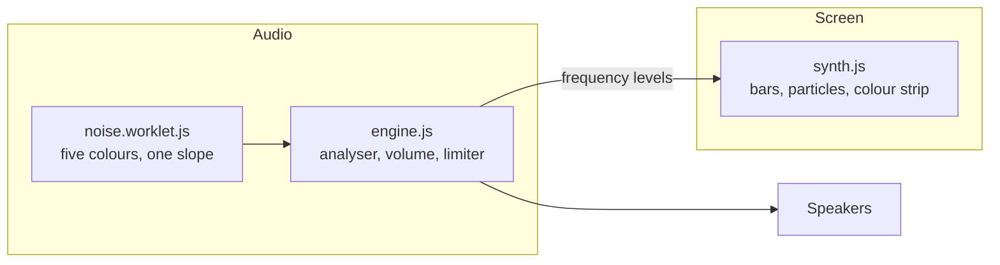

<p align="center">
  
</p>

<h1 align="center">Noise</h1>

<p align="center">
  <strong>Brown, pink, white, blue, and violet noise for focus.</strong><br/>
  A free app for Mac, Windows, Linux, and the web.
</p>

<p align="center">
  <a href="https://github.com/furey/noise/releases/latest"></a>
  
  
  
  
  
</p>

<p align="center">
  <a href="#download"><strong>Download for your computer →</strong></a>
</p>

<https://github.com/user-attachments/assets/9101b7cf-be2e-47a7-813e-6bc56a319606>

## Contents

- [Overview](#overview)
- [Download](#download)
- [First open](#first-open)
- [Web app](#web-app)
- [Using the app](#using-the-app)
- [Privacy](#privacy)
- [Development](#development)
- [Disclaimer](#disclaimer)
- [Contributing](#contributing)
- [Support](#support)

## Overview

**Noise** plays steady noise to help you focus. A tap starts the sound. The screen is a grid of blocks that moves with the sound, like the display of an old hardware synth.

There are five colours of noise. Each colour is a slope: the change in loudness from one octave to the next. A lower colour has more bass; a higher colour has more treble.

| Colour | Slope            | Key |
| ------ | ---------------- | --- |
| Brown  | `−6 dB` / octave | `1` |
| Pink   | `−3 dB` / octave | `2` |
| White  | `0 dB` / octave  | `3` |
| Blue   | `+3 dB` / octave | `4` |
| Violet | `+6 dB` / octave | `5` |

Between two colours, the sound is a blend of both. Noise has no accounts, no tracking, and no adverts. It remembers your colour and volume for the next time.

## Download

Choose your computer below. Each link downloads the newest version.

| Computer                                  | Download                                                                                                       |
| ----------------------------------------- | -------------------------------------------------------------------------------------------------------------- |
| Mac (any Mac)                             | [`Noise-Mac.dmg`](https://github.com/furey/noise/releases/latest/download/Noise-Mac.dmg)                       |
| Mac with an Apple chip (smaller download) | [`Noise-Mac-Apple-Chip.dmg`](https://github.com/furey/noise/releases/latest/download/Noise-Mac-Apple-Chip.dmg) |
| Mac with an Intel chip (smaller download) | [`Noise-Mac-Intel.dmg`](https://github.com/furey/noise/releases/latest/download/Noise-Mac-Intel.dmg)           |
| Windows PC                                | [`Noise-Windows.exe`](https://github.com/furey/noise/releases/latest/download/Noise-Windows.exe)               |
| Linux                                     | [`Noise-Linux.AppImage`](https://github.com/furey/noise/releases/latest/download/Noise-Linux.AppImage)         |
| Linux on ARM (such as a Raspberry Pi)     | [`Noise-Linux-ARM.AppImage`](https://github.com/furey/noise/releases/latest/download/Noise-Linux-ARM.AppImage) |

If you are not sure which Mac you have, download the first Mac file; it works on every Mac. To check the chip, open the Apple menu and choose **About This Mac**. A **Chip** line (Apple M1, M2, or later) means an Apple chip. A **Processor** line that says Intel means an Intel chip.

On a phone or tablet, use the [web app](#web-app). All versions are on the [releases page](https://github.com/furey/noise/releases).

## First open

- [First open overview](#first-open-overview)
- [First open on a Mac](#first-open-on-a-mac)
- [First open on Windows](#first-open-on-windows)
- [First open on Linux](#first-open-on-linux)

### First open overview

Noise is free and open source. Anyone can read its code in this repository. Apple and Microsoft charge every year for the certificate that signs an app, so the app is unsigned. Because of this, your computer shows a warning the first time you open it. The steps below show each warning and the button to press.

> [!NOTE]<br>
> The pictures in the steps below are illustrations of the system messages, not screenshots. The wording on your computer can differ a little.

The desktop app blocks all network access. It reads and writes only its own settings.

### First open on a Mac

Your steps depend on your macOS version. To check it, open the Apple menu and choose **About This Mac**.

- [macOS 15 Sequoia and later](#mac-macos-15-sequoia-and-later)
- [macOS 14 Sonoma and earlier](#mac-macos-14-sonoma-and-earlier)

#### Mac: macOS 15 Sequoia and later

1. Open the `.dmg` file you downloaded.
2. Drag **Noise** into the **Applications** folder.
3. Open the **Applications** folder and double-click **Noise**.
4. A message says "Noise" Not Opened. Click **Done**. Do not click **Move to Trash**.

   <p align="center">
     
     <br/><em>Illustration: the first macOS message</em>
   </p>
5. Open the Apple menu and choose **System Settings**.
6. Click **Privacy & Security** in the sidebar.
7. Scroll down to the **Security** section.
8. Next to "Noise" was blocked to protect your Mac, click **Open Anyway**.

   <p align="center">
     
     <br/><em>Illustration: Open Anyway in Privacy &amp; Security</em>
   </p>
9. Click **Open Anyway** in the next message.

   <p align="center">
     
     <br/><em>Illustration: the Open Anyway message</em>
   </p>
10. Type your Mac login password, or use Touch ID, when your Mac asks.

The **Open Anyway** button stays for about one hour after you first try to open the app. If it is gone, do steps 3 and 4 again, then continue from step 5.

#### Mac: macOS 14 Sonoma and earlier

1. Open the `.dmg` file you downloaded.
2. Drag **Noise** into the **Applications** folder.
3. Open the **Applications** folder.
4. Hold the Control key and click **Noise**.
5. Choose **Open**.
6. Click **Open** in the message.

   <p align="center">
     
     <br/><em>Illustration: the Open message</em>
   </p>

You do these steps once. After that, the app opens with a double-click.

### First open on Windows

Microsoft Edge can stop the download with the message **Noise-Windows.exe isn't commonly downloaded**. Edge shows this message for new files that few people have downloaded. To keep the file:

1. In the Edge downloads list, point to the file and click the **...** (More actions) button.
2. Click **Keep**.
3. If Edge asks again, click **Show more**.
4. Click **Keep anyway**.

To open the app after the download:

1. Double-click the `.exe` file you downloaded.
2. If a blue message says Windows protected your PC, click **More info**. If no message appears, go to step 5.

   <p align="center">
     
     <br/><em>Illustration: Windows protected your PC</em>
   </p>
3. If you saw the message, check that the **Publisher** line says Unknown publisher.
4. If you saw the message, click **Run anyway**.

   <p align="center">
     
     <br/><em>Illustration: Run anyway</em>
   </p>
5. Wait for the app to install and open. It installs for your Windows user only, and it is in the Start menu after that.

### First open on Linux

1. Open your file manager and find the `.AppImage` file you downloaded.
2. Right-click the file and choose **Properties**.
3. Click the **Permissions** tab.
4. Turn on **Allow executing file as program**. Newer versions of GNOME Files call it **Executable as Program**. KDE Dolphin calls it **Is executable**.

   <p align="center">
     
     <br/><em>Illustration: Allow executing file as program</em>
   </p>
5. Close the **Properties** window.
6. Double-click the file.

To do the same in a terminal, run these commands in the folder with the file. On Linux on ARM, the file is `Noise-Linux-ARM.AppImage`.

```console
chmod +x Noise-Linux.AppImage
./Noise-Linux.AppImage
```

If the app does not open on Ubuntu 22.04 or later, install FUSE, which every AppImage needs:

- On Ubuntu 22.04, run `sudo apt install libfuse2`.
- On Ubuntu 24.04 or later, run `sudo apt install libfuse2t64`.

## Web app

Open [noise.furey.dev](https://noise.furey.dev) in a browser on any device. You do not need to install anything.

To add Noise to the home screen of a phone or tablet:

- **iPhone or iPad**: open the page in Safari, tap the **Share** button, then tap **Add to Home Screen**.
- **Android**: open the page in Chrome, tap the **⋮** menu, then tap **Add to Home screen** or **Install app**.

From the home screen, Noise opens full screen, like an app. After the first visit, it works with no internet connection.

## Using the app

- [Controls](#controls)
- [Sleep timer](#sleep-timer)
- [Wave mode](#wave-mode)
- [Keyboard](#keyboard)
- [Rounded screens](#rounded-screens)
- [Desktop window](#desktop-window)
- [Background play](#background-play)

### Controls

The screen has two parts: the synth, which fills most of the screen, and the colour strip, the three rows of colour at the bottom.

- **Play**: tap the synth. A tap on the colour strip also plays.
- **Pause**: tap the synth while the sound plays.
- **Colour**: tap or drag along the colour strip. A white block, three cells wide and three cells high, marks the colour you hear.
- **Volume**: while the sound plays, drag up or down on the synth, from `10%` to `100%`. At a louder volume, the bars are taller and more particles fly off them.

When the app opens, the grid stays black for `300` ms, then the blocks fade in over about `0.8` seconds. Each launch picks a pattern at random: scattered, up, down, left, right, out from the centre, or in from the edges. If your device asks for reduced motion, the grid shows at once.

On a touch screen, the colour strip stays hidden until the first tap. Phone browsers start sound only on a tap, not at the end of a drag, so the first touch must be a tap. The strip then rises into view, bottom row first.

With a mouse, the pointer shows what a click or drag does: a hand on the synth while the sound is stopped, up and down arrows on the synth while it plays, and left and right arrows on the colour strip.

The desktop app:

<https://github.com/user-attachments/assets/ee7ef664-f6c9-4650-a2b1-7e207c67f67e>

On a tablet:

<https://github.com/user-attachments/assets/b9e48965-3d42-4e37-908c-37a339a38556>

On a phone:

<https://github.com/user-attachments/assets/e15cf3a5-a4d8-465f-a115-f682836eae33>

### Sleep timer

The timer is in the top-right corner. When it is off, it is one dim dot. Each tap moves it to the next setting:

| Setting      | Dots        |
| ------------ | ----------- |
| `30` minutes | `3`         |
| `20` minutes | `2`         |
| `10` minutes | `1`         |
| Off          | `1` dim dot |

One dot goes out every `10` minutes. A tap on the timer moves it to one dot fewer than you see. While the sound plays, the dots blink: full brightness for one second, then dimmer for one second.

The timer counts down only while the sound plays. In the last minute, the sound fades out, then it stops.

### Wave mode

The dot in the top-left corner turns wave mode on and off. The dot is white while wave mode is on, and dim while it is off. A tap on the dot is the only way to turn wave mode on. `Esc`, a pause, and the end of the sleep timer also turn it off.

If the sound was off when you turned wave mode on, and you touched nothing else, turning wave mode off also stops the sound. If the sound was already playing, or you changed the colour, volume, timer, or play state during wave mode, the sound carries on.

In wave mode, the colour slides to brown. Then the noise rises and falls like waves on a beach:

1. The colour rises from brown to a crest between pink and blue, most often near pink. The volume swells a little at the same time.
2. The colour holds at the crest for `0.6`–`2.2` seconds.
3. The colour eases back to brown and rests there for a few seconds.

Each rise takes `4.5`–`8` seconds and each fall takes `5`–`9` seconds, so no two waves are the same. A tap or drag on the colour strip moves the wave to that colour, and the wave carries on from there.

The synth changes shape in wave mode. The bars point out from the centre of the screen and make a circle that turns slowly, each bar with a white peak block. When you pause, the circle shrinks into the centre and empties.

### Keyboard

| Key       | Action                                    |
| --------- | ----------------------------------------- |
| `Space`   | Play or pause                             |
| `Esc`     | Stop the sound and wave mode              |
| `1`–`5`   | Play brown, pink, white, blue, or violet  |
| `←` / `→` | Move the colour a quarter step down or up |
| `↑` / `↓` | Turn the volume up or down by `5%`        |
| `T`       | Move the timer to the next setting        |

Screen readers get a **Play** button, a **Noise colour** slider, a **Volume** slider, a **Wave mode** button, and the timer button.

### Rounded screens

On a phone with rounded screen corners, the browser reports a safe area at the top or bottom of the screen. When it does, the app moves the timer and wave dots down to the third row, clear of the corners. It also lifts the colour strip by whole rows until it is clear of the home bar, with dim cells in the colours of the strip below it. On most iPhones, the strip moves up two rows. The app measures the safe area again after the page loads and after `500` ms, because some browsers report it late.

On a Mac, the desktop app has no title bar. The timer and wave dots sit on the first row that starts at least `40` px from the top of the window, clear of the window buttons. That is the second row at the default size, and lower in small windows, where the blocks are smaller. `Cmd+W` closes the window and quits the app.

### Desktop window

The first time it opens, the window is `800` × `600`, centred on the screen under the mouse pointer. On a smaller screen, it fits the screen. You can make it as small as `280` × `220`, small enough for a corner of the screen. The grid of blocks changes to fit each size. While you resize the window, the grid fades out and only the background shows. When you stop, the grid fades back in, block by block, as it does at start-up. With a mouse or trackpad, the blocks shrink from `22` px to as small as `11` px as the window gets smaller, so a small window keeps about `20` rows. Touch screens keep blocks of at least `22` px, so a finger can still hit them.

To keep the window above other windows, choose **View → Always on Top**. On Windows and Linux, press `Alt` to show the menu bar. The app remembers the size and position of the window, and the Always on Top setting.

### Background play

The sound keeps playing in the background where the browser allows it. The app also gives play and pause actions to the media controls of your device. The desktop app keeps playing when you minimise it.

The grid redraws at most `60` times a second, even on a `120` Hz screen. On a computer with four CPU cores or fewer, it redraws at most `30` times a second. It does not redraw while it is still, hidden, or minimised. Memory stays flat over long sessions.

In wave mode, the app gives the browser the next `2` seconds of the wave ahead of time. A background tab runs timers only once a second, so the sound still rises and falls smoothly there.

## Privacy

- **No network**: after the page loads, Noise makes no network requests. The desktop app blocks all network requests.
- **No accounts**: there is nothing to sign up for and no tracking.
- **Local storage**: the app keeps only your colour and volume, in the browser's `localStorage`. The desktop app also keeps the size and position of its window, and the Always on Top setting.

## Development

- [Development overview](#development-overview)
- [Commands](#commands)
- [How it works](#how-it-works)
- [Demo media](#demo-media)
- [Build workflow](#build-workflow)

### Development overview

Noise is plain JavaScript, built with [Vite](https://vite.dev). The desktop app is an [Electron](https://www.electronjs.org) window around the same web app. Node.js `24` is required.

```console
git clone https://github.com/furey/noise.git
cd noise
npm install
npm run dev
```

### Commands

| Command              | Effect                                                                                               |
| -------------------- | ---------------------------------------------------------------------------------------------------- |
| `npm run dev`        | Starts the Vite development server                                                                   |
| `npm test`           | Runs the unit tests                                                                                  |
| `npm run test:e2e`   | Builds the web app, then opens it in Electron and checks start-up, sound, and lock-down              |
| `npm run lint`       | Runs ESLint                                                                                          |
| `npm run build`      | Builds the web app into `dist`                                                                       |
| `npm start`          | Builds the web app and opens it in Electron                                                          |
| `npm run dist:mac`   | Builds the macOS `.dmg` files (any Mac, Apple chip, and Intel)                                       |
| `npm run dist:win`   | Builds the Windows installer                                                                         |
| `npm run dist:linux` | Builds the Linux AppImages (`x86_64` and `arm64`)                                                    |
| `./deploy.sh`        | Builds the web app and copies `dist` to the server behind [noise.furey.dev](https://noise.furey.dev) |
| `npm run icons`      | Makes the app icons from the SVG files in `build/icon-source`                                        |

The `dist:*` commands write to `release`. `npm run icons` needs `rsvg-convert`, and on a Mac it also makes the `.icns` file with `iconutil`.

### How it works

One audio worklet makes all five colours. Its `position` parameter, from `0` (brown) to `4` (violet), sets the slope. The engine plays the worklet through a volume control and a limiter. An analyser between them gives the synth the level of each frequency band, and the synth draws those levels as bars on a canvas.



The desktop app does not load files from disk directly. [`electron/main.mjs`](./electron/main.mjs) serves the built `dist` folder over a private `app://` address, and blocks every `http`, `https`, `ws`, and `file` request. The window runs in Electron's sandbox, and the app refuses every permission request.

### Demo media

The scripts in [`scripts`](./scripts) make the pictures and videos in this README. They write to `docs/media`, and need Google Chrome and `ffmpeg`. Set `CHROME_PATH` if Chrome is not in `/Applications`.

The video and social scripts open the built app at `http://localhost:4173/`. Start it first:

```console
npm run build
npm run preview
```

Then, in a second terminal:

| Script                             | Makes                                                                              |
| ---------------------------------- | ---------------------------------------------------------------------------------- |
| `node scripts/record-demo.mjs`     | `demo-desktop`, `demo-ipad`, `demo-iphone`, and `demo-devices` (`.mp4` and `.png`) |
| `node scripts/capture-social.mjs`  | `social.png`, the preview picture for links to the repository                      |
| `node scripts/render-icon-gif.mjs` | `app-icon.gif` and `app-icon.png`                                                  |

Add `--only desktop,iphone` to `record-demo.mjs` to record only some of the videos, and `--out <folder>` to write them somewhere other than `docs/media`. The videos in this README are GitHub attachments. To replace one, run `./scripts/upload-demo.sh docs/media/<name>.mp4` and put the URL it prints in this README. The script uses the upload endpoint behind GitHub's comment box, with your `gh` login; if GitHub retires it, drag the `.mp4` into any GitHub comment box instead. The [`docs-media`](https://github.com/furey/noise/releases/tag/docs-media) release keeps a copy of each file; the icon at the top of this README loads from it. The sound in each video is not a recording: the script runs the noise worklet in Node.js and follows the same taps and drags as the video.

### Build workflow

[`build.yml`](./.github/workflows/build.yml) runs on a push to `main` or `develop`, a version tag, a pull request, or by hand. On macOS, Windows, and Ubuntu runners it runs `npm run lint`, `npm test`, and `npm run test:e2e` (under `xvfb` on Ubuntu), then builds the app with `electron-builder`. On Windows, it also installs the app and checks that the window opens. The builds are kept as workflow artefacts.

For a pushed version tag (e.g. `1.0.0`), a second job waits up to 30 minutes for the GitHub release of that tag. It then attaches the six files in [Download](#download) to the release, and no others. Only that job can write to the repository.

## Disclaimer

This project:

- Is licensed under the [GNU GPLv3 License](./LICENSE.txt) (`GPL-3.0-or-later`).
- Is written with the assistance of AI and may contain errors.
- Is provided as-is with no warranty. Use it at your own risk.

## Contributing

If you hit a problem or want to compare notes, start a thread in [Discussions](https://github.com/furey/noise/discussions).

## Support

If you've found this project helpful, consider supporting my work through:

[Buy Me a Coffee](https://www.buymeacoffee.com/furey) | [GitHub Sponsorship](https://github.com/sponsors/furey)
