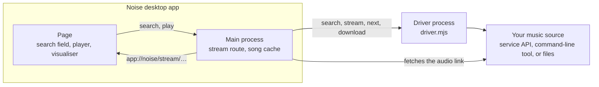

# Noise: Music drivers

## Contents

- [Overview](#overview)
- [Quick start](#quick-start)
- [How it works](#how-it-works)
- [Driver contract](#driver-contract)
- [Example driver](#example-driver)
- [Errors and limits](#errors-and-limits)
- [Song cache](#song-cache)
- [Configuration](#configuration)
- [Troubleshooting](#troubleshooting)
- [Writing a driver with AI](#writing-a-driver-with-ai)

## Overview

Noise plays two kinds of music:

- **Built-in music**: Liquid and Helix, two pieces the app composes as it plays. Turn them on with the top-middle button. They need no driver.
- **Songs by real artists**: tracks you search for and stream from a source you choose. A music driver connects Noise to that source.

Noise includes no source of artists' songs. With a driver installed, press `/` or choose **Controls → Search Music…**, type an artist or a title, and press `Enter` to play the best match. While a song plays, the built-in music and wave mode pause, and the colour follows the song's sound. When the song ends, the driver picks the next one.

With no driver, the app looks and works as it always does: no search key, no menu item, and no extra process.

> [!WARNING]<br>
> A driver runs with your user account's full access to your computer. Run only a driver that you wrote or have read.

## Quick start

- [1. Find the music folder](#1-find-the-music-folder)
- [2. Add the driver](#2-add-the-driver)
- [3. Restart the app](#3-restart-the-app)

### 1. Find the music folder

Both Noise and Noise 8bit read the same folder:

| System  | Folder                                      |
| ------- | ------------------------------------------- |
| macOS   | `~/Library/Application Support/Noise Music` |
| Windows | `%APPDATA%\Noise Music`                     |
| Linux   | `~/.config/Noise Music`                     |

### 2. Add the driver

Save your driver as `driver.mjs` in that folder. A symbolic link to a file kept elsewhere also works.

### 3. Restart the app

The app checks the driver when it starts. When the check passes, `/` and **Controls → Search Music…** appear.

## How it works

The app loads the driver in its own background process. The driver finds songs and audio links. The app plays them, saves them, and draws them.



- **Driver process**: starts when the app starts, checks the exports, then sleeps after `60` seconds without a call. The next call wakes it in about a second.
- **Stream route**: the page plays each song from `app://noise/stream/<token>`. The main process fetches the driver's audio link behind that address, with byte ranges for seeking. An expired link is renewed once.
- **Next song**: when a song starts, the app asks the driver for the songs that follow it and downloads the first one in the background.

## Driver contract

- [Exports](#exports)
- [Tracks](#tracks)
- [Albums](#albums)
- [Stream results](#stream-results)

### Exports

A driver is an ES module with these exports:

| Export       | Receives                    | Returns                                         |
| ------------ | --------------------------- | ----------------------------------------------- |
| `apiVersion` | none                        | the number `1`                                  |
| `search`     | `query`, `{ signal }`       | up to `5` tracks, best match first              |
| `stream`     | `track`, `{ signal }`       | `{ url, headers, mime, expiresAt, track }`      |
| `next`       | `track`, `{ signal }`       | tracks to play after this one                   |
| `download`   | `track`, `{ signal, path }` | `{ mime }`, after it writes the audio to `path` |
| `album`      | `album`, `{ signal }`       | the album's tracks, in order (optional)         |

The app rejects a driver whose `apiVersion` is not `1`, or which lacks `search`, `stream`, `next`, or `download`. A driver without `album` still loads, and the app drops any albums from its search results.

### Tracks

A track is `{ id, title, artist, durationS }`:

- **`id`**: letters, digits, `_`, and `-` only, at most `64` characters. The app uses it as a folder name in the song cache.
- **`title`**: required.
- **`artist`, `durationS`**: optional. The search field shows them when they are present.

### Albums

A search result can be an album: `{ id, title, artist, kind: 'album', trackCount }`.

- **`kind`**: the string `'album'`. A result with any other `kind` is a track.
- **`trackCount`**: optional. A whole number, which the search field shows as "12 songs".
- **`id`**: the same rules as a track `id`. The app never passes an album `id` to `stream` or `download`.

When you choose an album, the app calls `album` and plays its tracks in order from the first. After the last track, it starts again from the first. The driver decides when a search returns albums, for example when the query ends with the word "album".

### Stream results

- **`url`**: an `https` address, or an `http` address on this computer (`127.0.0.1`, `localhost`, or `[::1]`). A driver that serves your own files can run a small local web server for this.
- **`headers`**: any request headers the address needs, as strings.
- **`mime`**: an audio type such as `audio/webm`, `audio/mp4`, or `audio/mpeg`.
- **`expiresAt`**: the time in milliseconds when the address stops working, or `0`.
- **`track`**: optional. A fuller copy of the track, for example with the artist or length that `search` did not know.

## Example driver

This driver shows the shape only. `askSource` is the one function to write; replace it with calls to a music source you have the right to use.

```javascript
export const apiVersion = 1

export const search = async (query, { signal }) => {
  const results = await askSource({ action: 'search', query, signal })
  if (!results.length) throw coded('not-found', `No match for ${query}`)
  return results.slice(0, 5).map(trackOf)
}

export const stream = async (track, { signal }) => {
  const audio = await askSource({ action: 'audio-link', id: track.id, signal })
  return {
    url: audio.link,
    headers: audio.headers ?? {},
    mime: audio.type,
    expiresAt: audio.expiresAt ?? 0,
    track: trackOf(audio.details),
  }
}

export const next = async (track, { signal }) => {
  const related = await askSource({ action: 'related', id: track.id, signal })
  return related.map(trackOf)
}

export const download = async (track, { signal, path }) => {
  const saved = await askSource({ action: 'save', id: track.id, to: path, signal })
  return { mime: saved.type }
}

export const album = async (album, { signal }) => {
  const songs = await askSource({ action: 'album-songs', id: album.id, signal })
  return songs.map(trackOf)
}

const trackOf = item => ({
  id: item.id,
  title: item.title,
  artist: item.artist ?? '',
  durationS: item.seconds ?? 0,
})

const askSource = async ({ action, signal, ...details }) => {
  throw coded('unavailable', `Connect ${action} to your music source`)
}

const coded = (code, message) => Object.assign(new Error(message), { code })
```

`askSource` can call a web API with `fetch`, or run a program with `execFile` from `node:child_process`. Pass `signal` to either, so the app can cancel the call. A program the driver runs needs its full path, because an app started from the Dock or Start menu does not see your shell's `PATH`.

## Errors and limits

Throw an error with a `code` to tell the app what went wrong:

| Code          | Meaning                                     | The app shows              |
| ------------- | ------------------------------------------- | -------------------------- |
| `not-found`   | the source found nothing                    | "No match"                 |
| `unavailable` | the source failed or refused                | "Music source unavailable" |
| `cancelled`   | the driver stopped because `signal` aborted | nothing                    |

Any other error counts as `unavailable`. The app also stops waiting after these times, and reports a timeout:

| Call       | Time limit |
| ---------- | ---------- |
| `search`   | `20` s     |
| `stream`   | `20` s     |
| `next`     | `30` s     |
| `download` | `5` min    |
| `album`    | `30` s     |

A new search cancels the search still running. After `3` songs in a row fail to play, playback stops.

## Song cache

The app saves each song you play to `cache/` in the music folder, using `download`, and plays it from there next time. Each song is a folder with an `audio` file and a `meta.json`. Both apps share the cache.

When the cache passes `2 GB`, the app deletes the songs you played least recently. The song that is playing is never deleted.

## Configuration

These environment variables change the defaults. Set them before you start the app.

| Variable                  | Default                          | Notes                                              |
| ------------------------- | -------------------------------- | -------------------------------------------------- |
| `NOISE_MUSIC_DIR`         | the music folder for your system | a different music folder                           |
| `NOISE_MUSIC_CACHE_BYTES` | `2147483648` (`2 GB`)            | the cache size limit, in bytes                     |
| `NOISE_MUSIC_IDLE_MS`     | `60000`                          | how long the driver process waits before it sleeps |

## Troubleshooting

**`/` does nothing and there is no Search Music… item**

- The app found no valid driver. Check that the file is named `driver.mjs` and sits in the music folder.
- Read `driver.log` in the same folder. A rejected driver logs the reason, for example `Driver rejected: the driver lacks next`.
- Restart the app after any change to the driver.

**"Music source unavailable"**

- The driver threw an error without a known `code`, or a call ran past its time limit.
- Anything the driver prints with `console.log` goes to `driver.log`. The app moves a log over `1 MB` to `driver.log.old` when it starts.

**A song shows in the list but never plays**

- `stream` must return an `https` address, or an `http` address on this computer.
- Check that the address works with the `headers` you return, and that it is ready when `stream` returns.

## Writing a driver with AI

- [Writing with AI overview](#writing-with-ai-overview)
- [Sample prompts](#sample-prompts)

### Writing with AI overview

An AI coding agent can write a driver from this page. Give it this file, tell it where your music comes from, and ask it to keep the contract above. Then save the result as `driver.mjs`, restart the app, and read `driver.log` if search does not appear.

> [!TIP]<br>
> Ask the agent to test each function with a small Node script before you install the driver. A driver that throws on load never reaches the app.

### Sample prompts

For music files on your computer:

```text
Read docs/music-driver.md from the Noise repo. Using its example driver, write a driver.mjs that searches the music files in ~/Music by title and artist tags. Serve each file from a small local web server on 127.0.0.1 so stream can return an http address, and make download copy the file to the given path. Keep the exports and error codes exactly as the contract says, and pass signal everywhere.
```

For a music server you run at home:

```text
Read docs/music-driver.md from the Noise repo. Write a driver.mjs for my music server, which has an HTTP API at https://music.example.home with an API key that I keep in ~/.config/my-music/key. Map its search, stream, and "similar songs" endpoints to search, stream, and next, and its download endpoint to download. Return the audio link and any headers the server needs, and throw not-found when a search finds nothing.
```

For a command-line music tool:

```text
Read docs/music-driver.md from the Noise repo. Write a driver.mjs that runs a command-line music tool at /usr/local/bin/my-music-tool with execFile. It has search, link, related, and save commands that print JSON. Call the tool by its full path, pass signal so the app can cancel it, and turn the tool's exit codes into the not-found and unavailable error codes.
```
